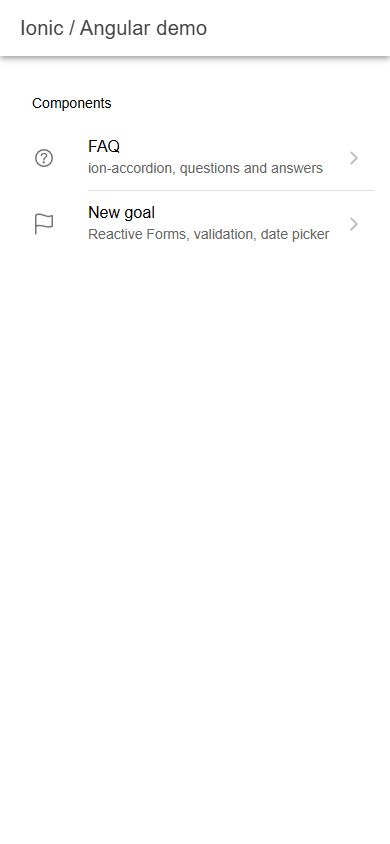
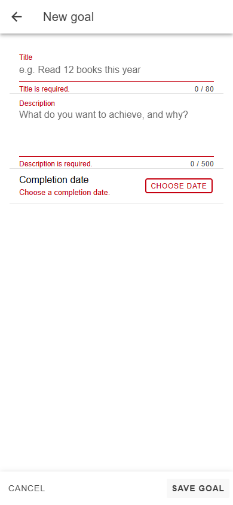
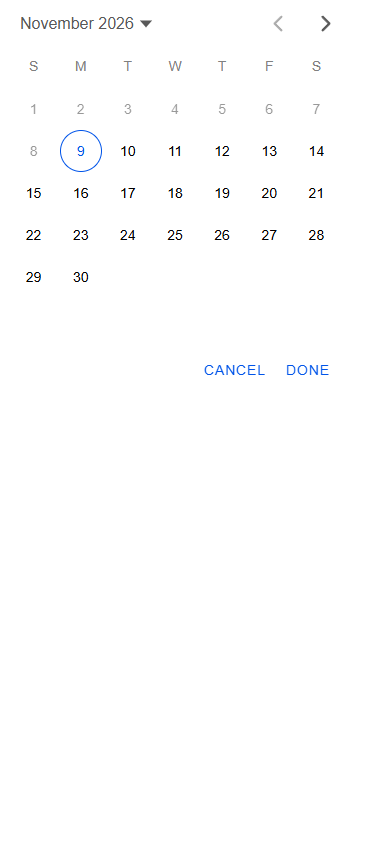
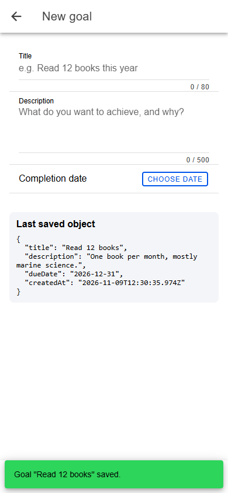

# Ionic / Angular demo

A small demo of two typical screens of a hybrid mobile app, built with **Ionic 9**, **Angular 22** (standalone components) and **Capacitor 8**.

| Home | FAQ | Goal: validation | Goal: date picker | Goal: saved |
|---|---|---|---|---|
|  |  |  |  |  |

## What is inside

**FAQ** (`src/app/faq`)
- `ion-accordion-group` with one accordion per question; several answers can be open at once.
- The questions and answers come from a typed list (`faq.data.ts`), so the texts can be replaced without touching the template.

**New goal** (`src/app/goal`)
- Angular **Reactive Forms**: title (required, 3–80 characters), description (required, max. 500), completion date (required, not in the past).
- Custom validator `notInPastValidator` (`src/app/shared/date.validators.ts`), with unit tests.
- Error messages appear only after the user touches a field, or when saving an invalid form.
- Date picker: `ion-datetime` in an `ion-modal`, with past dates disabled.
- On save, the valid data becomes a typed `Goal` object. It goes to `GoalService` (no backend: kept in memory and logged to the console) and is shown on screen, with a confirmation toast.
- Cancel resets the form and goes back.

## Run

```bash
npm install
npm start             # http://localhost:4200
npm run test:unit     # Vitest
npm run lint          # ESLint + Prettier
```

On a device: `npx cap add android`, then `npx cap run android`.
